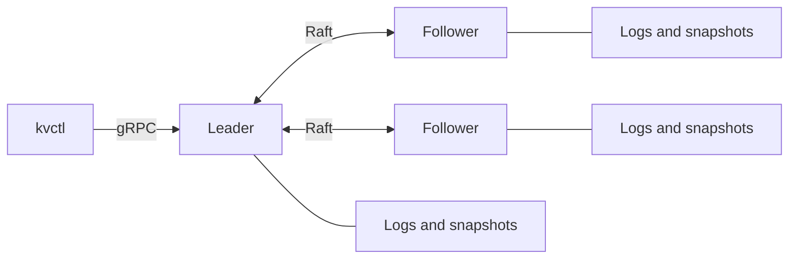
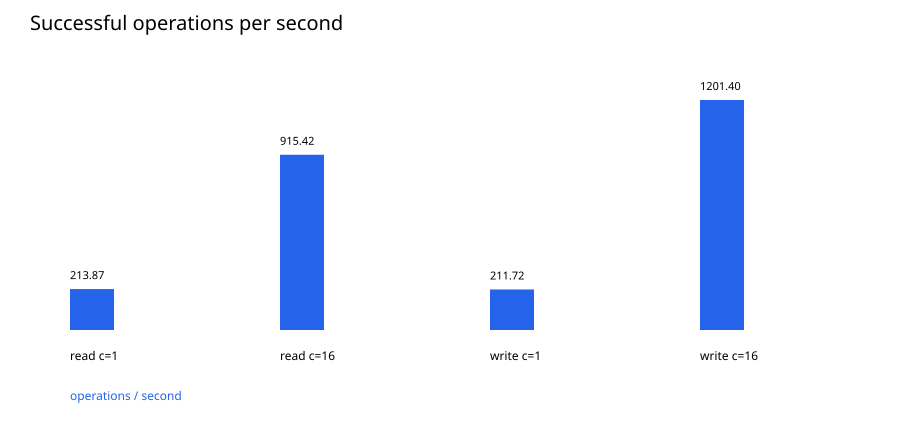
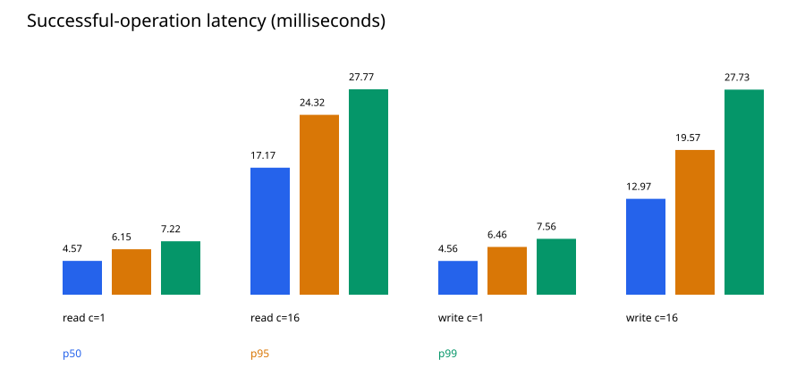

# Distributed Key-Value Database

I built a small database that keeps the same data on three Go servers. I can
save a value, read it, update it, or delete it from the command line. If one
server crashes, the other two can keep working.

I used this project to learn how servers agree on data, choose a leader, and
recover after a crash. I used HashiCorp Raft for consensus, gRPC and Protocol
Buffers for the API, and BoltDB for persistent Raft logs.



## Run it

I use Go 1.24 or newer to build the project. Docker Desktop with Compose runs
all three servers with one command. Python 3 is only needed for benchmarks.
The generated protobuf files are included, so protoc is optional.

```sh
make build
make start
```

Without Make, I can build the commands directly and start Compose:

```sh
go build -o bin/server ./cmd/server
go build -o bin/kvctl ./cmd/kvctl
go build -o bin/benchmark ./cmd/benchmark
docker compose up --build -d
```

On Windows, I add `.exe` to each output name and CLI command. For example:
`go build -o bin/kvctl.exe ./cmd/kvctl`.

After a few seconds for the leader election, I can try:

```sh
./bin/kvctl --addr localhost:7001 status
./bin/kvctl --addr localhost:7001 put name Stephen
./bin/kvctl --addr localhost:7001 get name
./bin/kvctl --addr localhost:7001 put name Alex
./bin/kvctl --addr localhost:7001 delete name
```

The first Get prints `Stephen`. Successful Put and Delete commands print
nothing. Reading a deleted or missing key returns a `NotFound` error.

The CLI asks the selected server where the leader is, then sends the operation
there. If that server is down, I use another address, such as `localhost:7002`.
The CLI runs on the host machine because Compose advertises host addresses.
Ports 7001, 7002, and 7003 are only exposed locally.

I stop the cluster with `docker compose down` or `make stop`. Each node has its
own persistent volume. Normal shutdown keeps the data; adding `-v` erases it.

### Without Docker on Windows

After building all three `.exe` files, I can start a native cluster from
PowerShell in the project folder:

```powershell
$peers = "node1=127.0.0.1:9001=127.0.0.1:7001,node2=127.0.0.1:9002=127.0.0.1:7002,node3=127.0.0.1:9003=127.0.0.1:7003"

$nodes = foreach ($i in 1..3) {
    $serverArgs = @(
        "--id", "node$i", "--listen", "127.0.0.1:700$i",
        "--raft", "127.0.0.1:900$i", "--data", "data/node$i",
        "--peers", $peers
    )
    if ($i -eq 1) { $serverArgs += "--bootstrap" }
    Start-Process -FilePath "$PWD\bin\server.exe" -ArgumentList $serverArgs `
        -WorkingDirectory $PWD -WindowStyle Hidden -PassThru
}

.\bin\kvctl.exe --addr localhost:7001 status
```

I wait a few seconds if the leader is still being elected. To stop these
processes in the same PowerShell window:

```powershell
$nodes | ForEach-Object { Stop-Process -Id $_.Id }
```

Starting them again reuses `data/node1`, `data/node2`, and `data/node3`. I keep
node IDs, addresses, and the peer list the same. Only node1 bootstraps, and it
skips that step when saved Raft state already exists. I do not erase its data
and bootstrap it into an existing cluster.

## How it works

One server is the leader. For a write, it sends the change through Raft and
waits until a majority of servers has recorded it. It then applies the change
to its map before returning success. With three servers, a majority is two.

A successful write survives one server crashing while the remaining replicas
and disks stay healthy. If two servers are unavailable, reads and writes fail
because the remaining server cannot confirm the correct state.

Before a read, I use Raft's `VerifyLeader()` and `Barrier()`. These check that
the server can still reach a majority and has applied earlier changes. Just
checking a local leader flag could allow an isolated old leader to return
stale data.

Each node saves Raft logs and metadata to disk. Snapshots save a copy of the
map so recovery does not need to replay the entire history. On restart, Raft
loads a snapshot and replays the needed logs. A returning follower catches up
from the other servers.

The [API](api/kv.proto) has four calls: Put, Get, Delete, and Status. I limit
keys to 1-256 bytes and values to 1 MiB. Empty keys and oversized inputs return
`InvalidArgument`. Deleting a missing key succeeds. Followers reject data
operations with `FailedPrecondition` and the known leader address.

Data requests have a five-second server limit and respect shorter client
deadlines. A timed-out write or delete **may still have committed**, so my CLI
never automatically retries a submitted mutation. Status reports local
information; it does not prove that the cluster can make progress.

## Test it

```sh
gofmt -l cmd internal api
go vet ./...
go test -count=1 -v ./...
go build ./...
```

Formatting should print no filenames, vet should print no errors, and tests
should finish with `PASS` and `ok`.

I test basic operations, invalid inputs, missing keys, and snapshots. The
integration test starts three separate processes in temporary directories,
kills the leader, checks previously saved data, writes more data, and restarts
the failed node. It also restarts the whole cluster and checks that losing two
nodes causes safe errors. These tests use their own cluster.

Formatting, vet, tests, and builds passed locally. My local builds used
`-buildvcs=false` because the sandbox's Git ownership check blocked build
metadata. I also verified CRUD with three running native servers.

I configured GitHub Actions to run formatting checks, vet, race tests, and
builds. I attempted `go test -race ./...` locally, but Windows had no compatible
C compiler. Docker was also unavailable, so I have not verified the Compose
build or launch.

### Try a leader crash

With Compose running, I check Status on ports 7001-7003 to find the leader.
**If node1 is the leader**, I run:

```sh
./bin/kvctl --addr localhost:7001 put name Stephen
docker compose kill -s SIGKILL node1
./bin/kvctl --addr localhost:7002 status
./bin/kvctl --addr localhost:7002 get name
docker compose start node1
```

I repeat Status until a new leader is known, then Get should return `Stephen`.
If another node was leader, I kill that service and use a surviving address.

## Benchmarks

I run the benchmark suite after building all three binaries:

```sh
python scripts/benchmark.py --n 2000 --repeats 5 --out results-local
```

It creates a temporary three-node cluster, tests reads and writes at concurrency
1 and 16, and repeats leader crashes five times. Each workload preloads 100 keys
with 256-byte values and runs 100 warmup operations before measurement.

I save raw samples, errors, latency percentiles, and charts. Throughput counts
successful operations per second. The p50, p95, and p99 numbers show the latency
below which 50%, 95%, and 99% of successful requests finished.

These are my November 2, 2026 results using Go 1.26.1 on Windows 11, an Intel
i7-1355U, about 13.6 GiB usable RAM, and a SK hynix SSD. All three processes ran
on the same machine. Each row measured 2,000 operations.

| Workload | Concurrency | Ops/sec | p50 ms | p95 ms | p99 ms | Duration s | Errors |
| --- | ---: | ---: | ---: | ---: | ---: | ---: | ---: |
| Read | 1 | 213.87 | 4.57 | 6.15 | 7.23 | 9.35 | 0 |
| Read | 16 | 915.42 | 17.17 | 24.32 | 27.77 | 2.18 | 0 |
| Write | 1 | 211.72 | 4.56 | 6.46 | 7.56 | 9.45 | 0 |
| Write | 16 | 1201.40 | 12.97 | 19.57 | 27.73 | 1.66 | 0 |

The five recovery times were 2.26, 1.76, 1.63, 1.82, and 3.45 seconds, with a
median of **1.82 seconds**. I measured from the kill request to a successful
read through the new leader, including CLI probes and polling.

These short local runs show how the project behaves on my machine. I would
need longer tests on separate machines to make broader performance claims.




The [results folder](results/) contains raw workload samples, recovery trials,
and environment details, including the exact hardware record. New runs using
the command above go into `results-local` and leave these recorded results alone.

## Interview walkthrough

- **One write:** I validate the request, submit it through Raft, wait for a
  majority to record it, and apply it before returning success.
- **One failure:** two of three servers can still agree and elect a leader.
- **Two failures:** one server cannot form a majority, so operations fail.
- **Safe reads:** I verify leadership and wait for earlier changes to be applied.
- **Timeouts:** I cannot assume a failed response means the write did not happen.
- **Next steps:** I would add encrypted, authenticated connections, request IDs
  to handle retries, and more network and disk failure tests.

## Limits

I kept this as an educational project with one fixed group of three servers.
There is no sharding, dynamic membership, authentication, or transaction API.
Each server holds the whole dataset in memory, so RAM limits its size.

Running all three nodes on one laptop does not protect against losing that
laptop or its disk. My crash tests cover process failures, not power loss or
disk corruption. The project also makes no guarantee against losing a majority
of replicas or all disks.
